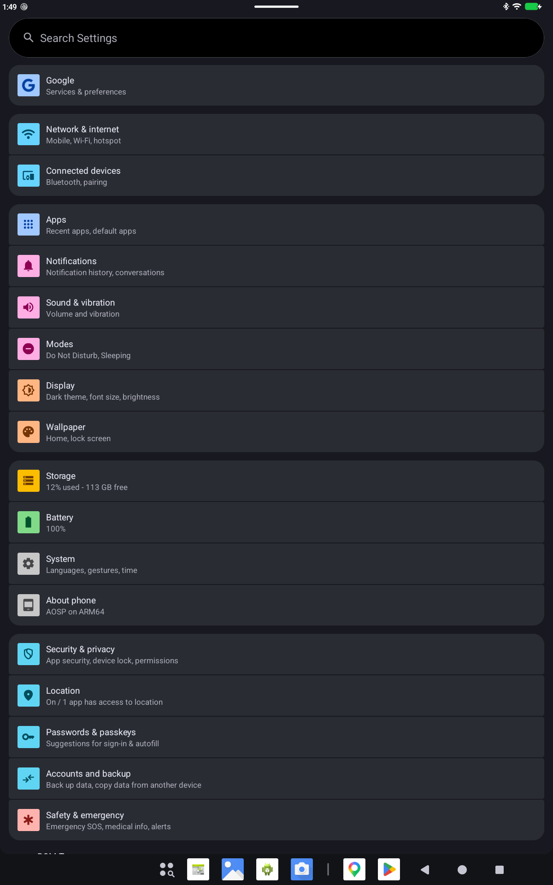
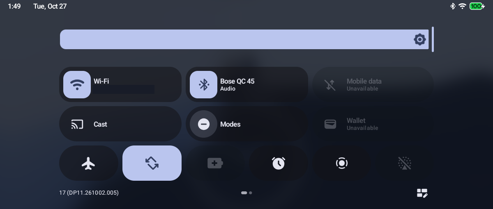
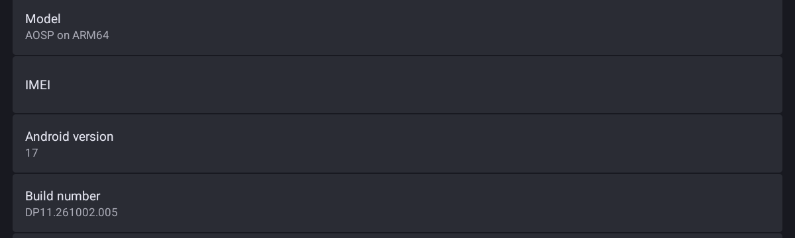
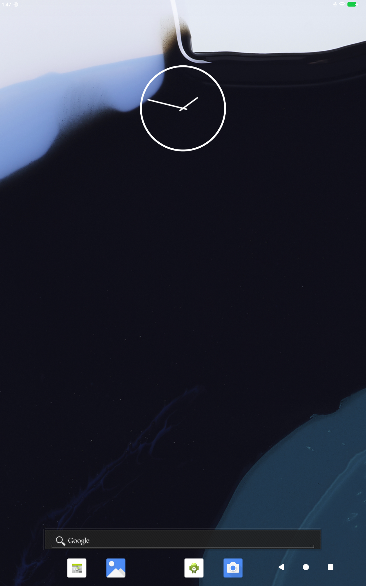
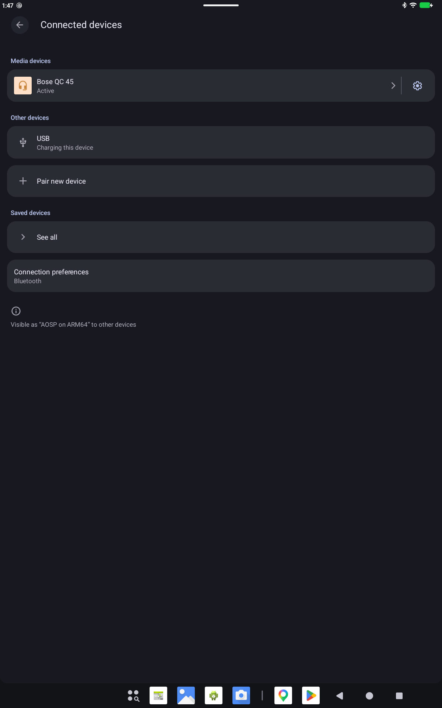

# Android 17 on the Lenovo TB-X606V

Google's Android 17 GSI (`aosp_arm64`, build DP11.261002.005) running on the Lenovo Tab M10 FHD Plus (TB-X606V, MT8768), with the stock
Android 10 vendor image and the stock 4.9.190 kernel. It boots to a working UI. Wi-Fi, Bluetooth, audio, camera, brightness and the keyboard work, and
Settings opens in under a second once the apps are compiled. Cellular, USB mode switching and DRM playback do not work (see "Known issues").

This repository holds the patches, helper tools and notes. It is not a turnkey build: most of the fixes were applied to a live system
over adb and TWRP, and `build/build_image17.py` only reproduces the early part of that (see "Using this").

Companion repositories:
- [`tb-x606v-kernel`](https://github.com/manvindar/tb-x606v-kernel): the 4.9 kernel patches and CI build. The final setup does not use it (see below).
- [`tb-x606v-android16-port`](https://github.com/manvindar/tb-x606v-android16-port): the Android 16 build for this tablet, the known good fallback. It uses the same Gemini boot animation by default.

## Install the prebuilt image

Images are on the [Releases page](https://github.com/manvindar/tb-x606v-android17/releases): `system-a17-tb-x606v-gapps.img.xz` (with Google apps) or `...-nogapps.img.xz`. They are dumps of the tested
partition with the main system apps already compiled, so the first boot is not slow. They contain Google's Android 17 GSI (and Google's apps in the gapps image), under Google's terms. Dolby Atmos is not in them.

**You need (once):** a TB-X606V on the stock Android 10 firmware (tested on `TB-X606V_USR_S300665_2206300345_V9.56_BMP_ROW`), an unlocked bootloader, TWRP in the recovery partition, USB debugging on,
and Android platform-tools (`adb`, `fastboot`) and `xz` on the computer. Flashing erases all data on the tablet.

```sh
git clone https://github.com/manvindar/tb-x606v-android17 && cd tb-x606v-android17
# 1. backup (tablet in TWRP: hold Volume Up + Volume Down while it starts)
tools/scripts/backup_partitions.sh
# 2. install: unpacks the image, flashes it, applies the vendor changes through TWRP, reboots
tools/scripts/install_a17.sh ~/Downloads/system-a17-tb-x606v-gapps.img.xz
```

`install_a17.sh` does everything below; the manual version is here in case you prefer to type it yourself:

| Step | Command | Why |
|---|---|---|
| bootloader | `adb reboot bootloader` (or power off, hold Power + Volume Down) | |
| vbmeta | `fastboot --disable-verity --disable-verification flash vbmeta tools/vbmeta/vbmeta-disabled.img` | switches Android Verified Boot verification off |
| system | `fastboot flash system system-a17-tb-x606v-gapps.img` | the image (unpack the `.xz` first: `xz -dk file.img.xz`) |
| wipe | `fastboot format:ext4 userdata; fastboot erase metadata; fastboot erase cache` | Android 17 needs an unencrypted, freshly formatted `/data` |
| vendor | `fastboot reboot recovery`, then `tools/scripts/apply_vendor_a17.sh` | edits the vendor partition once (see below) |
| boot | `adb reboot` | the first boot takes several minutes |

**vbmeta.** This tablet's stock `vbmeta` already has the verification-disabled flag set (flags = 2; the bootloader state shows `orange` when it is unlocked), so on the tested tablet the vbmeta step changes nothing. It is there
because other firmware builds may not ship it that way, the same step other TB-X606F ROM threads ask for, and a modified system partition will not boot under verified boot. `tools/vbmeta/vbmeta-disabled.img` is a 4 KB
empty vbmeta with the verification-disabled flag (made with `avbtool make_vbmeta_image --flags 2`); skip it with `--no-vbmeta` if you want to leave your own vbmeta alone. Never touched by any script: `recovery`, `boot`, `lk`,
`nvram`, `nvdata`, `proinfo`, `persist` and every other partition (so TWRP and your IMEI/MAC data stay as they are).

**Vendor edits** (`apply_vendor_a17.sh`, once, from TWRP; originals are saved as `*.orig-a17`/`*.orig-mp2`/`*.orig-vp9`): the fstab legacy flags Android 17 rejects and a `/metadata` line, `ueventd.rc` with `/dev/ion` opened,
seccomp policy additions, the MP2 audio decoder and software VP9 decoder removed from the codec lists, and the AIDL lights declaration for the brightness shim.

**Going back:** flash your backup (`fastboot flash system system.img` from the Android 10 firmware or from `backup_partitions.sh`, plus `vendor.img` if you want the vendor files back exactly) and wipe data.
`tools/restore_stock_boot.md` covers a tablet that no longer reaches the bootloader. After a flash, `tools/scripts/dexopt_all.sh` is only needed for apps you install later.

## Screenshots

| Settings | Quick settings | About phone |
|---|---|---|
|  |  |  |

| Home | Bluetooth (Bose QC 45 connected) |
|---|---|
|  |  |

## Status (2026-10-27)

| Area | State |
|---|---|
| Boot, `init`, SELinux (permissive), APEXes, `zygote`, `system_server` | works |
| eBPF loader, `netd`, ConnectivityService | works (patched binaries and jars bind-mounted over the APEX copies) |
| GPU, SurfaceFlinger, SystemUI, launcher, Settings | works |
| Wi-Fi | connects and stays connected |
| Camera | works (video encoding untested; the MediaTek encoders log "unsupported parameter") |
| Brightness | works, through a Java AIDL lights shim (`tools/lights`) |
| Keyboard (AOSP LatinIME) | works |
| Low memory killer | works, through a small replacement `lmkd` (`tools/lmkd`) |
| Bluetooth | works: turns on, scans, pairs, and connects (HFP and A2DP with a Bose QC 45; the A2DP stream starts and stops with playback) |
| Audio output | works (also in apps, YouTube plays with sound) through Android 16's `audioserver` and library closure run privately (`tools/audio`) |
| Google apps | install script works (Play Store runs) |
| YouTube playback | works with sound, 720p and up (hardware H.264; the vendor VP9 entry is removed); needed the `libui` usage-bit patch |
| Boot animation | Pixel 10 Gemini animation fitted to the panel (`tools/boot-animation`); see below |
| Cellular (calls, SMS, mobile data) | not working, see below |
| USB file transfer | works (checked with libmtp); tethering untested |
| DRM (Widevine) | HAL found, RKPD provisioning fails; playback untested |

First boot is slow until the apps are compiled. The GSI ships no odex, so every app runs from its APK. Run `tools/scripts/dexopt_all.sh`
once (it takes a few minutes): Settings goes from about 50 s to under a second cold.

## Known issues

From a read of the logs after a clean boot (no crashes, ANRs or service restarts):

- **Cellular.** The phone process reports "out of service" with an unknown radio HAL version, and Settings throws `UnsupportedOperationException` for the IMEI. The vendor radio (`mtkfusionrild`)
  only serves `android.hardware.radio@1.0/1.1` and `radio.config@1.0/1.1`, which Android 17's telephony does not accept (it wants a much newer HIDL version or AIDL). Making it work would need
  a radio HAL translation layer; not attempted. Needs a SIM to confirm.
- **USB.** `UsbDeviceManager` logs "usb gadget hidl hal service not found" (the vendor only has `android.hardware.usb@1.1`, port roles) and falls back to its legacy handler, which drives `sys.usb.config`.
  Checked: switching to file transfer works, and `libmtp` on the Mac lists the tablet's storage and folders. USB tethering is untested.
- **Widevine.** The vendor DRM HAL (`drm@1.2`, widevine instance) is found by the framework. The new `RkpdWidevine` provisioning (remote key provisioning for Widevine) fails with `ERROR_DRM_CANNOT_HANDLE`
  because the old HAL has no such property; the classic provisioning may still work. Protected playback is untested (it needs an app; a plain `app_process` test cannot open `MediaDrm`).
- **Harmless noise.** fs-verity setup fails on every permissions write (the kernel has no verity), the GPU memory BPF map and `bpf_system_stats` ringbuf iterator are missing, and fingerprint, face and a
  few other managers are absent on this hardware. The Wi-Fi data-stall monitor logs "ignore this poll" constantly.
- **Load average** sits around 25. It is MediaTek kernel threads in uninterruptible sleep, not CPU use (the cores are about 95% idle).
- `dumpsys bluetooth_manager` crashes the Bluetooth process (`ControllerImpl::Dump`); debug only.
- **A2DP input.** The legacy `a2dp` module used for A2DP input (acting as a sink) does not exist in the 5.0 HAL ("could not load HW module a2dp"). A2DP output to headphones works.

## Boot animation

The default is the Pixel 10 Gemini animation from [docbt/GeminiBootAnimation](https://github.com/docbt/GeminiBootAnimation) (MIT, Copyright (c) 2026 docbt). The original is 1080x2340;
`tools/boot-animation/make_gemini_fit.py` scales it to the 1200x1920 panel, centres it on black and reduces it to a 128-colour palette (13 MB, stored zip). Install it as
`/system/product/media/bootanimation.zip`. Other candidates that were previewed: ArrowOS (the leftover from the Android 16 customisation), a generated galaxy, the Lineage original,
and Pixel-style and Lenovo Yoga Smart Tab animations from the [Android Boot Animation Collection](https://github.com/tntapple219/Android-Boot-Animation-Collection) (unlicensed, not included).

## App audio (no sound in apps)

The 440 Hz test tone from a shell process played, but apps (YouTube) had no sound: `NPC::validatedUidPackagePair: controller never populated by system_server`. Android 17's `AudioService`
gets the `INativePermissionController` through the Java `IAudioPolicyService` proxy and fills it with the uid and package list. Two version differences broke that:

1. The Java proxy (in `framework.jar`, boot classpath) sends transaction 115 for `getPermissionController`; in Android 16 that number is `getMmapPolicyForDevice` and the controller is 113. The failure was silent because the
   start task runs on an executor. `tools/audio/patch_server_codes.py` points table entry 115 of A16's `BnAudioPolicyService::onTransact` jump table at the 113 handler (the table sits at the address `adr` loads, not at `pc + imm`; the first attempt wrote the wrong place and had no effect).
2. Once the controller is reachable, `populatePermissionState` rejects the A17 permission enum (A16 knows 16 values) with `EX_ILLEGAL_ARGUMENT`, and the exception on the `audioserver_lifecycle` thread kills `system_server`: boot loop, boot animation forever, no adb. `tools/audio/patch_audiopermission.py` makes it return success.

Install both patches or neither. Testing without involving `system_server`: a small `app_process` program that switches to uid 1000, fetches the controller with transaction 113 and calls the three populate methods shows exactly what the server accepts.

## Boot animation after a Tuner state from Android 16

ROM Tuner keeps its choice in `/data/local/tmp/tuner.state` and its daemon copies `bootanimation-<choice>.zip` over `bootanimation.zip` at every boot. A state file carried over from the Android 16 setup says `bootanim=arrow`
and silently replaced the Gemini animation; the default only applies when the key is missing. Set `bootanim=gemini` (or choose it in the Tuner).

## Google Maps crash

Maps (and any app registering an over-budget listener with the new `MemoryBudgetManager`) crashed at start with `IllegalStateException: Failed to register package budget listener`: the native register
functions in `libandroid_runtime.so` return 0 when the kernel cannot deliver memory budget events. `tools/libc/patch_libandroid_runtime.py` makes both natives return a dummy handle (no event ever fires).
Replace `/system/lib64/libandroid_runtime.so` with a new file and `mv` it (never overwrite in place).

## Video playback from the gallery

Recording worked but playing the clip failed: the Gallery picks `c2.android.avc.decoder` (software Codec2), which runs in `mediaswcodec` from the `com.android.media.swcodec` APEX. That APEX carries its own `libui.so`
with the same gralloc problems as the system one, and `mediaswcodec` aborted with `gralloc-mapper is missing`. `tools/libc/patch_libui.py` (both patches, 64-bit and 32-bit) is applied to the APEX copies, which are
bind-mounted from `/system/etc/bpf.a17/libui_swcodec{64,32}.so` by `00_bpf_bind.rc`.

## GPS

The vendor GNSS stack works end to end (`mnld` starts, NMEA flows, `system_server` receives satellite status) and gets a fix with the sky in view (confirmed on the tablet). Indoors there are no satellite signals.
Play services also needs `INSTALL_LOCATION_PROVIDER` for Google's network (Wi-Fi) location provider; MindTheGapps does not whitelist it, so `tools/gapps/privapp-permissions-gms-location.xml` adds it and
`install_gapps.sh` installs the file. On an already-booted system the grant is only evaluated when the package state is rebuilt (first boot after a flash does it), so a live install may need a data wipe or reinstall of Play services to bind it.
`wifi_scan_always_enabled` is on for network location.

## Video playback (green screen)

YouTube showed a green screen or "There was a problem while playing". The MediaTek OMX decoder asks for gralloc usage bit 13 (0x2000, the legacy `GRALLOC_USAGE_EXTERNAL_DISP`), and
Android 17's `libui` Gralloc2 path rejects it ("buffer descriptor contains invalid usage bits 0x2000"), so ACodec could not allocate the YV12 output buffers
(`dequeueBuffer failed: BAD_VALUE`). `tools/libc/patch_libui.py` now also drops bit 13 from the invalid-bits mask in the two validate functions (arm64). Replace the library with a new file and
`mv` it, not `cat >`: overwriting the mapped file in place restarted the whole framework once.

## Bluetooth profiles

Pairing worked but nothing could connect: the GSI sets none of the `bluetooth.profile.*` properties that AOSP's `bluetooth.mk` normally provides, so the Bluetooth app started no profile service
except hearing aid and never connected A2DP or HFP after pairing (the remote simply hung up after SDP). `build/build_image17.py` now appends those properties to `build.prop` (a2dp source, avrcp target,
hfp ag, hid host and device, gatt, bas client, opp, pan, asha, and a class of device). The `persist.sys.bt.unsupported.commands=182` property of the Android 16 / TrebleDroid workaround is also in
`build.prop`; the AOSP Bluetooth stack ignores it, and the binary patch in `tools/bpf/patch_bluetooth.py` does that job.

## Google apps

`tools/scripts/install_gapps.sh` installs [MindTheGapps](https://github.com/MindTheGapps/16.0.0-arm64) (the Android 16 build) into the running system over adb: Play services, Play Store, Services Framework, the
contact and calendar sync adapters and the permission, sysconfig and overlay files they need (about 290 MB; `--with-velvet`, `--with-speech` and `--with-wellbeing` add more). Setup Wizard is left out.
Everything it writes is listed in `/system/etc/gapps-installed.txt`, and `--remove` deletes exactly that. Verified: the system boots with it, Play Store starts and shows the account. Play services crashes
twice during the first boot with `Unexpected safety source: AdvancedProtection` (its Safety Center source is not in Android 17's config) and then stays up.

## Serial console warning

The GSI image is built debuggable here, so `init.rc` started the UART `console` shell and ActivityManager posted "Serial console enabled, performance is impacted" at every boot
(it checks `init.svc.console`). `init.rc` now starts the console only when `persist.sys.console=1`. The ROM Tuner (Behaviour > Serial console shell) switches it on and off at runtime;
`build/build_image17.py` applies the same `init.rc` edit.

## Why the stock kernel

The Lenovo open-source 4.9.117 kernel was tried first and dropped: its PowerVR driver rejects the vendor GPU firmware, so the display never comes
up. The stock 4.9.190 boot image works, so Android 17 userspace is patched to run on it instead. The kernel repo records the earlier path.

## What had to be fixed

Each item came from a real failure. `docs/ANALYSIS.md` has the evidence and the order they showed up in.

- **libc and the linker** abort at startup without `MADV_WIPEONFORK`; the madvise failure branch is patched out (`tools/libc/patch_libc.py`). The same folder
  patches `libui` (an API-level gate on the HIDL mapper fallback), `libmeminfo` (aborts on a missing gpuMem BPF map) and `libbinder`
  (the frozen-state callback ioctl does not exist on 4.9). `patch_pgsetup.py` fixes the cgroup2 mount options.
- **BPF.** `netbpfload`, `netd` and `libservice-connectivity` check for kernel 4.14 and newer map types. `tools/bpf` patches them, converts the LRU maps in
  `netd.o`, wraps the loader in a ptrace shim that sets `bpf.progs_loaded`, and bind-mounts everything over the APEX paths from `00_bpf_bind.rc`.
- **`service-connectivity.jar`.** The local-net and loopback BPF maps cannot exist on 4.9. `tools/framework/patch_service_connectivity_jar.py` skips them and turns the
  methods that touch them into no-ops. The first version only wrote the first code unit of each method and failed verification; `return-void` plus a `nop` is right.
- **`services.jar`** (`patch_services_jar.py`): a NullPointerException in `HintManagerService` with the old power HAL, a camera event subscription, and the
  `Build.isBuildConsistent()` dialog that the old vendor can never satisfy.
- **APEXes** that had to be edited are re-signed with a local AVB key and APK-signed (`tools/apex`).
- **Timeouts.** `ro.hw_timeout_multiplier=5` stops the activity manager and SystemUI from timing out on this CPU.
- **Vendor.** `/dev/ion` permissions, seccomp policies, ueventd (`tools/vendor`) and the fstab flags Android 17 rejects (`tools/fix_vendor_a17.py`).
- **Audio.** The vendor audio HAL is HIDL 5.0, which Android 17 no longer supports, and a 5.0 client from Android 16 does not fit A17's vtables (the 6.0 client has a different wire format: the offload info struct grew and methods were inserted). So `audioserver` and its roughly 164 libraries come from Android 16 and run from `/system/lib64/a16audio` through `LD_LIBRARY_PATH`. A17's clients differ in a few AIDL transaction numbers, so `tools/audio/fix_aidl_codes.py` rewrites them in the two A17 AIDL libs.
- **Low memory killer.** The Android 17 `lmkd` needs PSI or memcg, which 4.9 does not have. The idle stub that replaced it never listened on its socket, and the
  activity manager then slept and retried on every process change, which blocked it for seconds and made the watchdog restart `system_server`. The replacement
  speaks the lmkd protocol and drives the old in-kernel killer.
- **Brightness.** Android 17 only talks to the AIDL lights HAL and the vendor only has HIDL. The shim registers `android.hardware.light.ILights/default`
  (declared in a vendor VINTF fragment) and writes `/sys/class/leds/lcd-backlight/brightness`.
- **Bluetooth** (`tools/bpf/patch_bluetooth.py`): the controller answers an optional command with an unknown-command status that the stack treats as fatal, and
  then a check for Secure Simple Pairing aborts. Both branches are patched.

## Using this

You need a TB-X606V with an unlocked bootloader, TWRP in `recovery`, `adb` and `fastboot`, e2fsprogs, and **a backup of the stock `boot` partition**.
Flashing wipes userdata. Do not touch `recovery`.

`build/build_image17.py` builds the patched system image from the GSI and an Android 16 image (for the VNDK 29 APEX and SELinux mapping). The later fixes were
applied live: after the image boots, run the scripts and patchers in `tools/` (the bind-mounted files go to `/system/etc/bpf.a17/`, the init rc files to
`/system/etc/init/`), then `tools/scripts/dexopt_all.sh`. If you try this, expect to read `docs/ANALYSIS.md`.

`tools/restore_stock_boot.md` explains how to recover a tablet that no longer reaches TWRP or fastboot (MediaTek BROM with mtkclient).

## Not in this repository

Google's GSI, the Lenovo stock images and the vendor files are not included, and the patchers read them from your own copies. The Android and Lenovo files belong to their owners.
This is a personal experiment with no warranty: it can leave the tablet unbootable.
