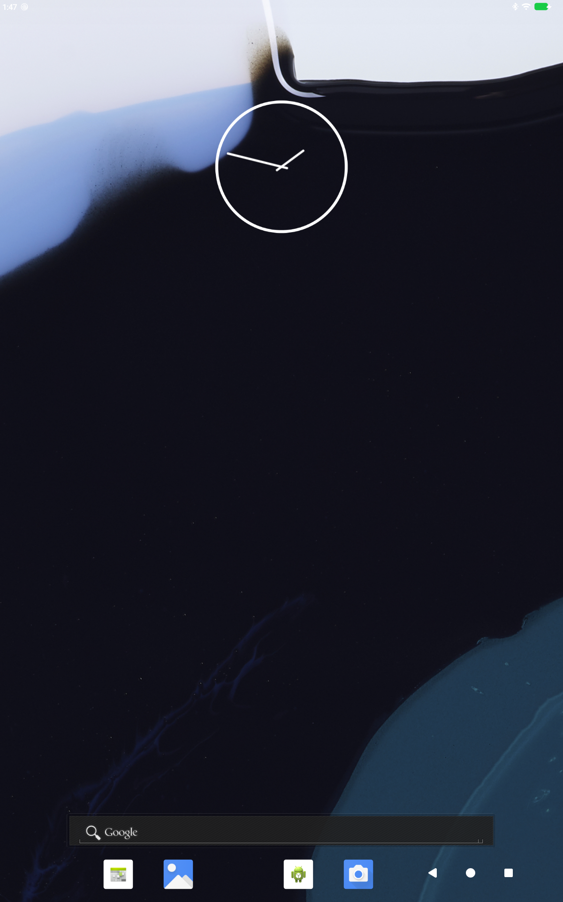
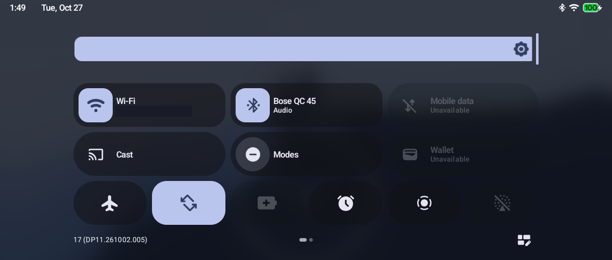
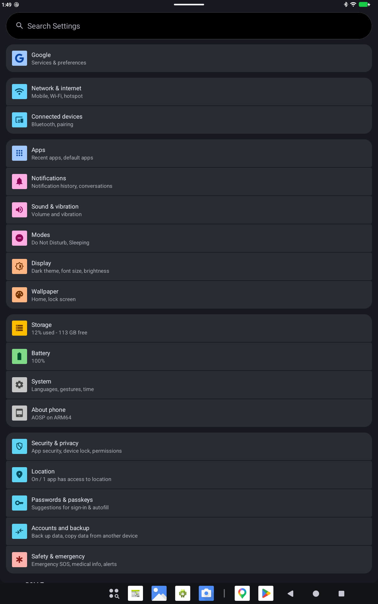

# Lenovo Tab M10 FHD Plus · Android 17

**TB-X606V · MediaTek MT8768 · Experimental GSI port**

[**Downloads**](https://github.com/manvindar/tb-x606v-android17/releases) · [**Current candidate**](https://github.com/manvindar/tb-x606v-android17/releases/tag/v17-rom-full-candidate-20261118) · [**Changelog**](CHANGELOG.md) · [**Builds**](https://github.com/manvindar/tb-x606v-android17/actions)

> [!WARNING]
> Images are for **TB-X606V only**. The current rebuilt System and new kernel candidate have not been boot-tested. The new kernel failed guards. Back up off-device and retain a working recovery route before considering installation.

## Choose a release

| Release | Android base / edition | Status |
| :--- | :--- | :--- |
| [Full candidate · November 18](https://github.com/manvindar/tb-x606v-android17/releases/tag/v17-rom-full-candidate-20261118) | QPR3 Beta 4 `DP11.261030.003`; non-Pixel, with/without Google apps | Rebuilt System, proven Boot reference, required r6g graphics module and an **untested, guard-failed** new Boot candidate |
| [Non-Pixel r1](https://github.com/manvindar/tb-x606v-android17/releases/tag/v17-qpr3-beta4-nonpixel-r1) | QPR3 Beta 4 `DP11.261030.003` | Earlier experimental System build |
| [Pixel Tablet r6](https://github.com/manvindar/tb-x606v-android17/releases/tag/v17-dp11-261016-pixel-r6) | `DP11.261016.003`; Pixel Tablet edition | Older Android base; its evidence does not validate Beta 4 |

The newest bundle is **non-Pixel**. A matching Beta 4 Pixel edition has not been delivered; the repository's [two-edition build policy](AGENTS.md) remains open for that base.

## Current bundle

Download from the [November 18 candidate release](https://github.com/manvindar/tb-x606v-android17/releases/tag/v17-rom-full-candidate-20261118).

| File | Purpose |
| :--- | :--- |
| `system-a17-tb-x606v-gapps-nodexopt.img.xz` | Complete System image with Google apps |
| `system-a17-tb-x606v-nogapps-nodexopt.img.xz` | Complete System image without Google apps |
| `boot-r5b-proven.img` | Previously running Boot reference; distinct from the new candidate |
| `boot-candidate.img` | New CI-built kernel: **guard-failed, runtime-untested** |
| `pvr113-stage-r6g.zip` / `payload-r6g.psv` | Required matching PowerVR 1.13 graphics module and payload manifest |
| `SHA256SUMS` / `raw-image.sha256` | Download and extracted-image checksums |
| `TWRP-FLASH.md` / `README-ROM.md` | Release-specific installation instructions and limitations |
| Kernel, provenance and guard receipts | Build configuration, symbols, binary and recorded checks |

These are separate complete files. The graphics fixes are in the **Magisk module**, not a bundled vendor image. No precompiled Android Runtime app caches are baked into System; first-boot compilation and persistence remain unverified for this bundle.

## Installation

Read [TWRP-FLASH.md in the release](https://github.com/manvindar/tb-x606v-android17/releases/download/v17-rom-full-candidate-20261118/TWRP-FLASH.md) and [README-ROM.md](https://github.com/manvindar/tb-x606v-android17/releases/download/v17-rom-full-candidate-20261118/README-ROM.md) before choosing a route. Verify checksums and decompress `.xz` files before raw-image flashing.

> [!IMPORTANT]
> The PowerVR 1.13 kernel needs matching r6g userspace **enabled before boot**. Stock 1.11 userspace with that kernel is a known zygote-loop combination. Module extraction must preserve symlinks; the public module activation/TWRP procedure has not been tested. The proven Boot reference does not validate the rebuilt System or the new kernel candidate.

Existing compatible installations and first installs have different prerequisites. Older generic installers may wipe userdata and do not implement the current graphics activation sequence. Keep verified System/Boot backups and preserve Recovery, NVRAM/NVDATA, personal files and unrelated partitions. See [historical setup notes](docs/HISTORICAL-SETUP.md) for older routes, not current-candidate instructions.

## What has been checked?

| Area | Evidence and limits |
| :--- | :--- |
| Release files | Checksums, compressed streams, Boot headers and pinned components checked; public uploads verified |
| Rebuilt System | CI filesystem/image checks passed; exact images not boot-tested |
| New kernel | Guards failed; DTB build step failed; binary differs from r5b for an unexplained reason |
| r5b + r6g on earlier System | Observed running on one tablet; owner reports green video overlay fixed |
| App compilation | Owner reports slight subjective improvement; no measured gain or persistence claim |
| Historical hardware | Earlier Wi-Fi, Bluetooth, audio, camera, brightness and UI checks; not acceptance of this bundle |

Matching kernel configuration and symbols do **not** establish binary equivalence. Recorded failures include sensor-contract, config-gate, export-accounting and private-compare. Export accounting reports **90 CRC mismatches / 7 absent exports**, versus the pinned **82 / 6** baseline. The `achilles6_row_call.dtb` step failed.

## Known limits

- Notification-shade lag remains. App completion delays were observed; workload, driver signalling, queueing and compositor attribution remain unresolved.
- Cellular compatibility remains unresolved; do not rely on calls, SMS or mobile data.
- SELinux is permissive. The older setup uses unencrypted userdata; first-install formatting erases data.
- Historical Netflix playback was observed, but Widevine security level and maximum resolution were not measured. USB file transfer was checked historically; tethering remains unverified.
- Long-term stability, new-image hardware compatibility, compilation persistence and performance gains remain unverified.

## Screenshots

Earlier tablet screenshots; appearance is not proof of current-candidate validation.

| Home | Quick settings | Settings |
| :---: | :---: | :---: |
|  |  |  |

## Build and development

The [image builder](build/build_image17.py) applies compatibility patches to public inputs. [Beta 4 input pins](docs/BETA4-INPUTS.json), [port notes](docs/BETA4-PORT.md) and the [image workflow](.github/workflows/build-image.yml) record the System build. The full bundle's release provenance identifies its separate kernel and packaging build.

[Architecture notes](docs/ANALYSIS.md) · [Pixel layer](docs/PIXEL.md) · [Historical performance](docs/PERFORMANCE.md) · [Earlier setup and build commands](docs/HISTORICAL-SETUP.md)

Experimental ZUI SystemUI work is separate from the published bundle. A successful build or donor extraction does not establish device compatibility.
